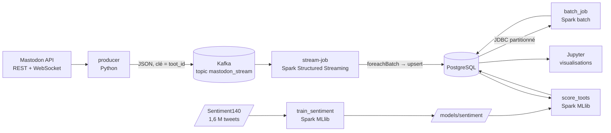

# Mastodon × Spark

Pipeline temps réel et batch sur les toots Mastodon : **Mastodon API → Kafka → Spark Structured Streaming → PostgreSQL**, puis analyses batch, sentiment (Spark MLlib) et visualisations dans Jupyter.

Spécifications : [CAHIER_DES_CHARGES.md](CAHIER_DES_CHARGES.md) · Avancement : [TODO.md](TODO.md)

## Architecture



| Partie de l'énoncé | Code | Tables PostgreSQL produites |
|---|---|---|
| 1. Ingestion Mastodon → Kafka | [producer/](producer/) | — (topic `mastodon_stream`) |
| 2. Stream processing | [streaming/stream_job.py](streaming/stream_job.py) | `toots`, `toot_hashtags`, `stream_window_counts`, `stream_user_stats`, `stream_hashtag_stats` |
| 3. Batch + optimisation | [batch/batch_job.py](batch/batch_job.py), [batch/benchmark.sh](batch/benchmark.sh) | `batch_daily_stats`, `batch_hashtag_daily`, `batch_hashtag_totals`, `batch_active_users`, `batch_benchmarks` |
| 4. Sentiment (MLlib) | [ml/train_sentiment.py](ml/train_sentiment.py), [ml/score_toots.py](ml/score_toots.py) | `sentiment_model_metrics`, `toot_sentiment` |
| 5. Visualisations | [notebooks/visualisations.ipynb](notebooks/visualisations.ipynb) | — (figures dans `notebooks/figures/`) |

Le schéma complet est dans [sql/init.sql](sql/init.sql).

## Prérequis

- Docker Desktop (≥ 8 Go de RAM alloués)
- [uv](https://docs.astral.sh/uv/) pour l'environnement Python local (producer, autocomplétion)

## Démarrage de bout en bout

```bash
# 1. Infrastructure + collecte + streaming (démarrent automatiquement)
cp .env.example .env          # optionnel : MASTODON_ACCESS_TOKEN pour le mode temps réel
uv sync                       # dépendances Python locales
docker compose up -d --build  # le premier build télécharge l'image Spark/Jupyter (~4 Go)

# 2. Laisser la collecte tourner (le backfill récupère ~200 toots par hashtag au démarrage)
docker compose logs -f producer

# 3. Batch (partie 3)
docker compose exec jupyter spark-submit /home/jovyan/work/batch/batch_job.py

# 4. Sentiment (partie 4) : télécharger Sentiment140 (cf. plus bas), entraîner, puis noter les toots
docker compose exec jupyter spark-submit /home/jovyan/work/ml/train_sentiment.py
docker compose exec jupyter spark-submit /home/jovyan/work/ml/score_toots.py

# 5. Visualisations (partie 5) : http://localhost:8888 → notebooks/visualisations.ipynb
```

## Démo temps réel

Montrer les toots qui arrivent dans PostgreSQL pendant la présentation, avec les requêtes de [sql/demo.sql](sql/demo.sql) (derniers toots reçus, toots par minute, hashtags de l'heure, volumes) rafraîchies toutes les 5 s :

```bash
while true; do clear; docker compose exec -T postgres psql -U mastodon -d mastodon < sql/demo.sql; sleep 5; done
```

Avec un client `psql` installé sur la machine : `psql -h localhost -p 5433 -U mastodon mastodon`, puis `\i sql/demo.sql` et `\watch 5`.

En complément : Kafka UI (http://localhost:8082, messages du topic en direct) et le Spark UI du job de streaming (http://localhost:4042, onglet *Structured Streaming*). Pour un flux continu pendant la démo, renseigner `MASTODON_ACCESS_TOKEN` : en mode polling, la limite de l'API (300 requêtes / 5 min) impose des pauses.

## Services et ports

Tous les ports sont publiés sur `127.0.0.1` uniquement (pas d'accès depuis le réseau local). Entre conteneurs, on utilise le nom du service et le port interne.

| Service | Port hôte | Port interne (conteneurs) | Accès depuis le PC | Rôle |
|---|---|---|---|---|
| `jupyter` | 8888 | `jupyter:8888` | http://localhost:8888 (token : `JUPYTER_TOKEN`) | Notebooks, driver Spark |
| `jupyter` | 4040, 4041 | `jupyter:4040-4041` | http://localhost:4040 | Spark UI des applications lancées depuis Jupyter (4041 pour une 2ᵉ en parallèle) |
| `stream-job` | 4042 | `stream-job:4040` | http://localhost:4042 | Spark UI du job de streaming |
| `spark-master` | 8080 | `spark-master:8080` | http://localhost:8080 | Interface du cluster Spark |
| `spark-master` | 7077 | `spark-master:7077` | `spark://127.0.0.1:7077` | Soumission des applications Spark |
| `spark-worker` | 8081 | `spark-worker:8081` | http://localhost:8081 | Interface du worker (4 cœurs, 3 Go) |
| `spark-history` | 18080 | `spark-history:18080` | http://localhost:18080 | Applications terminées (comparaison des optimisations) |
| `kafka` | 9094 | `kafka:9092` | `127.0.0.1:9094` (pas `localhost`, cf. ci-dessous) | Broker Kafka, topic `mastodon_stream` |
| `kafka` | — | `kafka:9093` | — | Contrôleur KRaft (interne) |
| `kafka-ui` | 8082 | `kafka-ui:8080` | http://localhost:8082 | Topics et messages Kafka |
| `postgres` | 5433 (`POSTGRES_HOST_PORT`) | `postgres:5432` | `localhost:5433` | Base `mastodon` |
| `producer` | — | — | `docker compose logs -f producer` | Collecte Mastodon → Kafka |
| `kafka-init` | — | — | — | Crée le topic au démarrage puis s'arrête |

- **PostgreSQL sur 5433** côté PC : le 5432 est souvent déjà pris par un PostgreSQL installé localement.
- **Kafka via `127.0.0.1`** : kafka-python ne retente pas en IPv4 quand `localhost` échoue en IPv6.

## Architecture Docker

- **Une seule image Spark** ([docker/spark/Dockerfile](docker/spark/Dockerfile)) pour le master, le worker, le History Server et Jupyter : driver et executors ont les mêmes versions (Spark 4.1.2, Python 3.13, Java 21). Les JARs Kafka et PostgreSQL sont intégrés à l'image.
- Le dossier du projet est monté sur `/home/jovyan/work` dans tous les conteneurs Spark, pour que driver et executors voient les mêmes chemins (datasets, modèles, checkpoints).
- Chaque application Spark est limitée à 2 cœurs ([spark-defaults.conf](docker/spark/spark-defaults.conf)) : le job de streaming et un notebook peuvent tourner en même temps.
- Le schéma PostgreSQL ([sql/init.sql](sql/init.sql)) n'est appliqué qu'au **premier** démarrage. Pour le réappliquer : `docker compose down -v` (⚠ supprime les données).

## Collecte des toots (producer)

Le service `producer` démarre avec la stack et publie les toots dans le topic `mastodon_stream`.

- **Sans token** : mode polling (interrogation toutes les `PRODUCER_POLL_INTERVAL` secondes).
- **Avec `MASTODON_ACCESS_TOKEN`** dans `.env` : mode streaming temps réel par WebSocket. Créer une application dans *Préférences → Développement → Nouvelle application* (portée `read:statuses` uniquement), copier « Your access token » dans `.env`, puis `docker compose up -d --force-recreate producer`.
- Au démarrage, `PRODUCER_BACKFILL_PAGES` pages d'historique (40 toots) sont récupérées par hashtag.

```bash
docker compose logs -f producer                                  # suivre la collecte
docker compose stop producer                                     # arrêter la collecte
uv run producer/mastodon_producer.py --mode poll --duration 60   # lancement local (test)
```

## Job de streaming (Kafka → PostgreSQL)

Le service `stream-job` lance [streaming/stream_job.py](streaming/stream_job.py) au démarrage de la stack. Il exécute 5 requêtes Structured Streaming :

| Requête | Table PostgreSQL | Contenu |
|---|---|---|
| `toots` | `toots`, `toot_hashtags` | Couche brute, toutes langues, dédoublonnée |
| `counts_1min` / `counts_1hour` | `stream_window_counts` | Toots par fenêtre (Action 1) |
| `user_stats` | `stream_user_stats` | Toots et longueur moyenne par utilisateur et par heure (Action 2) |
| `hashtag_stats` | `stream_hashtag_stats` | Toots et longueur moyenne par hashtag et par heure (Action 2) |

Les agrégats ne portent que sur les langues de `STREAM_LANGUAGES` (défaut `en`). Les tables `stg_*` sont des tables de staging techniques (écriture idempotente).

```bash
docker compose logs -f stream-job                                              # suivi
docker compose exec postgres psql -U mastodon -d mastodon -f /dev/stdin < sql/demo.sql   # démo
```

> Changer les requêtes (agrégations, `spark.sql.shuffle.partitions`) rend les checkpoints incompatibles : arrêter le job et supprimer `checkpoints/stream_job/` avant de relancer.

## Job batch (PostgreSQL → Spark → PostgreSQL)

[batch/batch_job.py](batch/batch_job.py) analyse tout l'historique des tables `toots` et `toot_hashtags` (lecture JDBC partitionnée) et recalcule entièrement les tables de résultats à chaque exécution :

| Table | Contenu |
|---|---|
| `batch_active_users` | Utilisateurs actifs (plus de `BATCH_ACTIVE_THRESHOLD` toots, défaut 5) : volume, longueur et engagement moyens, hashtag favori |
| `batch_hashtag_daily` | Toots par jour et par hashtag ; `rank = 1` pour le hashtag le plus fréquent du jour |
| `batch_hashtag_totals` | Totaux par hashtag sur tout l'historique |
| `batch_daily_stats` | Toots par jour, longueur moyenne, engagement moyen (favourites + reblogs), hashtag du jour |

```bash
docker compose exec jupyter spark-submit /home/jovyan/work/batch/batch_job.py
```

### Optimisation

L'option `--scenario` active les optimisations une par une, pour mesurer leur effet :

| Scénario | Optimisation |
|---|---|
| `baseline` | Aucune : chacune des 4 sorties relit PostgreSQL et recalcule tout le plan |
| `cache` | `toots` et `toot_hashtags` lus une seule fois puis gardés en mémoire (`persist`) |
| `repartition` | Les deux tables sont repartitionnées sur `toot_id` (4 partitions, et `spark.sql.shuffle.partitions = 4` au lieu de 200) : les jointures n'ajoutent plus de shuffle ; `coalesce(1)` avant l'écriture des résultats |
| `optimized` | `cache` + `repartition` (scénario par défaut) |

```bash
batch/benchmark.sh 3    # chaque scénario 3 fois, sur les mêmes données ; médianes affichées à la fin
```

Chaque exécution ajoute une ligne (durée de chaque étape, `app_id`) dans la table `batch_benchmarks` et apparaît dans le Spark History Server (http://localhost:18080), sous le nom `mastodon-batch-job [scénario]`.

Résultats du 09/10/2026 (12 079 toots, médiane de 3 exécutions, en secondes) :

| Scénario | Lecture | active_users | hashtag_daily | hashtag_totals | daily_stats | Calculs (hors lecture) | **Total** |
|---|---|---|---|---|---|---|---|
| `baseline` | 2.3 | 13.1 | 3.6 | 3.5 | 4.4 | 27.0 | **29.0** |
| `cache` | 7.5 | 7.5 | 2.0 | 2.5 | 1.6 | 13.8 | **21.3** |
| `repartition` | 2.4 | 12.1 | 2.2 | 2.3 | 2.0 | 18.6 | **21.0** |
| `optimized` | 7.3 | 7.5 | 1.9 | 2.0 | 1.5 | 13.4 | **20.8** |

- **cache** : la lecture coûte plus cher (matérialisation du cache), mais les 4 sorties ne relisent plus PostgreSQL : temps de calcul divisé par 2.
- **repartition** : 4 partitions de shuffle au lieu de 200 et jointures sans redistribution ; gain surtout sur les petites sorties (hashtag_daily, daily_stats).
- Le volume est petit : une part importante du temps est un coût fixe (démarrage des tâches, connexions JDBC, première exécution de `active_users`), ce qui limite le gain total à environ 28 %.

> Base créée avant l'ajout de ces tables : appliquer le schéma (idempotent, `IF NOT EXISTS`) avec
> `docker compose exec -T postgres psql -U mastodon -d mastodon -f /dev/stdin < sql/init.sql`.

## Analyse de sentiment (Spark MLlib)

### Données d'entraînement : Sentiment140

1,6 M tweets de 2009 étiquetés négatif (0) / positif (4), plus 498 tweets annotés à la main (dont 139 neutres). Téléchargement (~80 Mo, sans compte Kaggle) :

```bash
mkdir -p data/sentiment140
curl -L -o data/sentiment140/trainingandtestdata.zip http://cs.stanford.edu/people/alecmgo/trainingandtestdata.zip
unzip data/sentiment140/trainingandtestdata.zip -d data/sentiment140
```

### Entraînement

[ml/train_sentiment.py](ml/train_sentiment.py) : nettoyage (`SQLTransformer`) → `RegexTokenizer` → `StopWordsRemover` (sans retirer les négations : *not*, *don't*…) → `CountVectorizer` → `IDF`, puis `LogisticRegression` et `NaiveBayes` comparés sur 20 % de test (exactitude, F1, AUC, matrice de confusion). Le meilleur (AUC) est sauvegardé dans `models/sentiment/`, nettoyage compris ; les métriques vont dans la table `sentiment_model_metrics`.

```bash
docker compose exec jupyter spark-submit /home/jovyan/work/ml/train_sentiment.py   # ~10 min
```

Sentiment140 n'a que deux classes : un toot est **neutre** si sa probabilité « positif » est à moins d'une marge de 0,5. La marge est choisie sur le jeu annoté à la main (seule source de tweets neutres).

Résultats (1 280 507 tweets d'entraînement, 319 493 de test) :

| Modèle | Exactitude | F1 | AUC | Jeu manuel (pos/neg) |
|---|---|---|---|---|
| **LogisticRegression** (retenu) | **78,6 %** | 0,786 | **0,857** | 79,7 % |
| NaiveBayes | 76,2 % | 0,762 | 0,828 | — |

Marge neutre retenue : 0,20 (neutre si 0,30 ≤ p(positif) ≤ 0,70), exactitude sur 3 classes du jeu manuel : 57,4 %.

### Application aux toots

[ml/score_toots.py](ml/score_toots.py) note les toots en anglais (le modèle a appris sur des tweets anglais) et recalcule entièrement la table `toot_sentiment` (`positive` / `negative` / `neutral`, probabilité « positif », nom du modèle) :

```bash
docker compose exec jupyter spark-submit /home/jovyan/work/ml/score_toots.py
```

À relancer après un nouvel entraînement, ou une fois la collecte avancée.

> **Mémoire** : si Docker Desktop dispose de 8 Go ou moins, l'exécuteur peut être tué (code 137) pendant l'entraînement. Mettre le streaming en pause le temps de l'entraînement (aucune perte : les toots attendent dans Kafka et le job reprend depuis son checkpoint) :
> `docker compose stop stream-job kafka-ui`, entraînement, puis `docker compose start stream-job kafka-ui`.

## Visualisations (Jupyter)

[notebooks/visualisations.ipynb](notebooks/visualisations.ipynb) lit les tables PostgreSQL et trace, avec un commentaire sous chaque graphique : la fréquence des toots dans le temps, une heatmap d'activité jour × heure, le top 15 des hashtags, la distribution des sentiments, le sentiment par hashtag, les temps d'optimisation du batch et la matrice de confusion du modèle. Les figures sont aussi enregistrées dans `notebooks/figures/`.

Ouvrir http://localhost:8888 (token `JUPYTER_TOKEN`), ou l'exécuter en ligne de commande après avoir rafraîchi les résultats :

```bash
docker compose exec jupyter spark-submit /home/jovyan/work/batch/batch_job.py
docker compose exec jupyter spark-submit /home/jovyan/work/ml/score_toots.py
docker compose exec -w /home/jovyan/work/notebooks jupyter jupyter nbconvert --to notebook --execute --inplace visualisations.ipynb
```

## Lancer un job Spark

```bash
docker compose exec jupyter spark-submit /home/jovyan/work/<chemin/du/job.py>
```

> `docker compose exec jupyter python ...` ne trouve pas `pyspark` : utiliser `spark-submit`, ou un notebook.

## Commandes utiles

```bash
docker compose ps                     # état des services
docker compose logs -f <service>      # logs
docker compose down                   # arrêt (données conservées)
docker compose exec postgres psql -U mastodon -d mastodon
```
